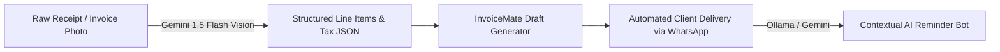

# ⚡ InvoiceMate

<div align="center">


### Modern Invoicing & Tax Compliance SaaS

*Effortless billing, 1-click WhatsApp delivery, quarterly GSTR-1 tax filing, and client ledgers—wrapped in a high-performance frosted-glass interface.*

[](https://openjdk.org/)
[](https://spring.io/projects/spring-boot)
[](https://developer.mozilla.org/en-US/docs/Web/JavaScript)
[](https://www.mysql.com/)
[](https://spring.io/projects/spring-security)
[](LICENSE)

[Live Demo](#-live-ui-preview) • [Key Features](#-features-at-a-glance) • [Architecture](#-system-architecture) • [Quick Start](#-quick-start) • [Future AI Roadmap](#-future-ai-roadmap) • [API Reference](#-api-endpoints)

</div>

---

## 💡 Why InvoiceMate?

Traditional billing software is bloated, slow, and forces users to navigate confusing menus. **InvoiceMate** solves this with:

- 🚀 **Instant Load Times**: Built with zero frontend frameworks (pure semantic HTML5, CSS3 variables, and reactive Vanilla JS). No 50MB `node_modules` bundles or sluggish render passes.
- 📱 **WhatsApp-Native Workflows**: Dispatch clean payment links, PDF invoices, and automated reminder nudges straight to customer WhatsApp in 1 click.
- 🇮🇳 **Indian Tax Ready**: Automatic quarterly GSTR-1 compilation, HSN/SAC code auto-fill, and CGST/SGST/IGST tax slab breakdowns.
- 🎨 **Invoza UI Design System**: A desktop-grade, frosted-glass window environment (`backdrop-filter: blur(20px)`) with keyboard command shortcuts (`/`).

---

## ✨ Features at a Glance

| Feature Module | What It Does | Why It Matters |
|:---|:---|:---|
| **🎨 4 Invoice Templates** | Real-time toggle between Modern, Business, Classic, and Minimal styles | Adapts to any business branding (tech agency to legal firm) |
| **📑 Estimates & Proposals** | Create formal quotes and convert them to invoices with 1 click | Speeds up client onboarding and deal closures |
| **💬 WhatsApp Dispatch** | Instant WhatsApp message and reminder link generator | 3x faster client payment turnaround |
| **📊 GSTR-1 Tax Engine** | Auto-categorizes turnover across Q1–Q4 with rate-wise slab splits | Saves hours of manual work during quarterly tax filing |
| **👥 Customer Statements** | Chronological debit/credit transaction history with running balances | Provides clean audit trails and transparent reconciliation |
| **📦 Product & HSN Catalog** | Preset product/service directory with auto-filling HSN/SAC codes | Eliminates manual tax rate mistakes on every line item |
| **🔁 Recurring Subscriptions** | Automate monthly, quarterly, or annual billing cycles | Ideal for retainer contracts and SaaS subscriptions |
| **🔒 Enterprise Auth** | Stateless JWT tokens, BCrypt hashing, and user-isolated data scopes | Guarantees complete data privacy and security |

---

## 🎨 Design Showcase

### 4 Pixel-Perfect Invoice Templates
- **Modern**: High-tech cobalt headers with crisp sans-serif typography.
- **Business**: Executive slate and lime corporate structure with dual billing summary cards.
- **Classic**: Warm parchment serif layout designed for formal contracts and accounting.
- **Minimal**: Swiss studio grid with generous whitespace and refined line borders.

### The Invoza Desktop Experience
- **Atmospheric Backdrop**: Ambient sky-and-meadow gradients with a floating frosted glass viewport.
- **Command Search**: Press `/` from anywhere to instantly focus navigation search.
- **3D Sphere Authentication**: Modern frosted capsule sign-in experience with interactive password eye reveal.

---

## 🤖 Future AI Roadmap

InvoiceMate is architected with modular service hooks ready to integrate Large Language Models (Google Gemini & OpenAI):



1. **Smart Receipt Vision OCR**: Snap a picture of a paper bill or receipt to automatically extract vendor, line items, and taxes directly into a draft invoice.
2. **Conversational Invoicing**: Type commands like *"Invoice Acme Corp ₹25,000 for quarterly SEO services due in 15 days"* to generate complete invoices in seconds.
3. **Autonomous Chaser Bot**: Analyzes customer payment history to dynamically craft polite, assertive, or urgent follow-up nudges on WhatsApp.
4. **Predictive Cash Flow Intelligence**: Forecasts incoming collections and highlights at-risk invoices based on historical settlement trends.

---

## 🏗️ System Architecture

```
┌─────────────────────────────────────────────────────────────────┐
│                    CLIENT BROWSER (Vanilla JS)                  │
│  ├── Layout Engine (layout.js, layout.css)                      │
│  ├── Live Preview & Real-Time Math (create-invoice.js)          │
│  └── Canvas Data Visualizations (Chart.js Spline)               │
└────────────────────────────────▲────────────────────────────────┘
                                 │ REST / JSON (fetch API)
┌────────────────────────────────▼────────────────────────────────┐
│                   SPRING BOOT 3.4.3 (Java 21)                   │
│  ├── Security: Spring Security + Stateless JWT Filter           │
│  ├── REST Controllers: 10+ Modular Resource Endpoints           │
│  ├── Business Logic: Tax, PDF Rendering, Invoicing Engines      │
│  └── Persistence: Spring Data JPA + Hibernate ORM               │
└────────────────────────────────▲────────────────────────────────┘
                                 │
┌────────────────────────────────▼────────────────────────────────┐
│                       PERSISTENCE LAYER                         │
│  • Local Dev: Embedded H2 File DB (jdbc:h2:file:./data)         │
│  • Production: MySQL 8+ with HikariCP Connection Pooling        │
└─────────────────────────────────────────────────────────────────┘
```

---

## 🚀 Quick Start

### 1. Clone the Repository
```bash
git clone https://github.com/kunj-sampat/InvoiceMate.git
cd InvoiceMate
```

### 2. Launch the Backend Server
```bash
cd backend
mvn spring-boot:run
```
> The API server boots in under **4 seconds** on `http://localhost:8080`.  
> An embedded H2 file database is initialized automatically with zero setup.

### 3. Open the Frontend
- Open `frontend/login.html` directly in any web browser to sign up and access the dashboard.
- Or explore the public marketing showcase at `frontend/index.html`.

---

## 📡 API Endpoints

| Category | Method | Endpoint | Description |
|:---|:---|:---|:---|
| **Auth** | `POST` | `/api/auth/register` | Register new business account |
| | `POST` | `/api/auth/login` | Authenticate and obtain JWT token |
| **Dashboard** | `GET` | `/api/dashboard/summary` | Summary cards, collection rate & health metrics |
| | `GET` | `/api/dashboard/revenue` | Invoiced vs. collected cash flow time series |
| **Invoices** | `GET` | `/api/invoices` | List invoices or estimates (`?isEstimate=true`) |
| | `POST` | `/api/invoices` | Create new invoice or quote |
| | `GET` | `/api/invoices/{id}/pdf` | Stream generated PDF document |
| **Ledger** | `GET` | `/api/customers/{id}/statement` | Chronological statement of account |
| **GST Tax** | `GET` | `/api/reports/gst` | Quarterly GSTR-1 turnover & slab calculations |
| **Payments** | `POST` | `/api/payments` | Record full/partial settlement |
| **Settings** | `POST` | `/api/settings/logo` | Upload custom business branding logo |

---

## 📁 Repository Structure

```
InvoiceMate/
├── backend/
│   ├── src/main/java/com/invoicemate/
│   │   ├── config/          # Security, JWT, CORS configurations
│   │   ├── controller/      # REST API Controllers
│   │   ├── dto/             # Request & Response DTOs
│   │   ├── model/           # JPA Entities (Invoice, Customer, Payment, etc.)
│   │   ├── repository/      # Spring Data Repositories
│   │   └── service/         # Invoicing, GST tax, and PDF generation logic
│   ├── src/main/resources/  # application.properties (H2/MySQL)
│   └── pom.xml              # Maven configuration
├── frontend/
│   ├── assets/              # Logos and SVG icons
│   ├── css/                 # Invoza design system, auth.css, template styles
│   ├── js/                  # API interceptor, live preview, chart adapters
│   ├── dashboard.html       # Analytics & cash flow spline chart
│   ├── invoices.html        # Invoice list & WhatsApp action dispatchers
│   ├── estimates.html       # Quote management & 1-click conversion
│   ├── customer-statement.html # Account ledgers
│   ├── products.html        # Product catalog & HSN/SAC codes
│   ├── recurring.html       # Automated subscription billing
│   ├── reports.html         # Quarterly GSTR-1 summaries
│   ├── settings.html        # Branding, logo uploader & defaults
│   ├── create-invoice.html  # Split-screen invoice builder
│   ├── invoice-detail.html  # Status timeline, payment recording modal
│   ├── login.html           # 3D sphere frosted glass sign-in
│   ├── register.html        # Account creation page
│   └── index.html           # Public landing page
├── database/                # Production MySQL schemas
├── .env.example             # Environment template for keys and secrets
└── .gitignore               # Multi-layer exclusion (AI keys, models, binaries)
```

---

## 🛡️ Security & Privacy

- **Stateless Tokens**: Auth relies entirely on industry-standard JWT tokens with expiration handling.
- **Key Hygiene**: All `.env`, `api_keys.json`, and credentials are strictly ignored via `.gitignore`.
- **User Scoping**: All database queries enforce strict user tenancy isolation so users can never view or manipulate another account's records.

---

## 👤 Author

**Kunj Sampat**  
- GitHub: [@kunj-sampat](https://github.com/kunj-sampat)  
- Email: [kunjsam31@gmail.com](mailto:kunjsam31@gmail.com)

---

## 📄 License

Distributed under the MIT License. See `LICENSE` for more information.
